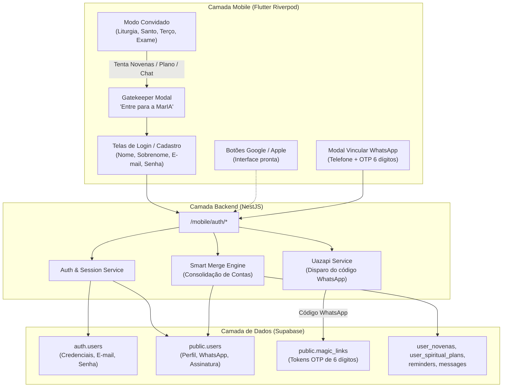

# Arquitetura e Plano de Implementação: Autenticação Híbrida & Sincronização Omnichannel (Mobile + WhatsApp)

> **Status:** Plano de Arquitetura e Especificação Técnica  
> **Data:** 17 de Outubro de 2026  
> **Versão Alvo:** 1.34.0  
> **Objetivo:** Implementar o sistema completo de autenticação e identidade no app mobile MarIA com modelo híbrido (Acesso Convidado Livre para Liturgia/Santo/Terço + Gatekeeper Devocional para Novenas/Plano de Vida/Lembretes/Chat), autenticação por E-mail/Senha no Supabase Auth, UI preparada para Google e Apple, e vinculação com Smart Merge de contas do WhatsApp via OTP com Uazapi.

---

## 1. Visão Geral e Princípios Fundamentais

### 1.1 Modelo Híbrido Inspirado em Referências de Mercado (Hallow & Capela)
1. **Acolhimento Pastoral Imediato (Modo Convidado):**
   - O fiel pode baixar o app e, sem nenhum cadastro, orar o Santo Terço, ler a Liturgia Diária completa, ler a biografia e oração do Santo do Dia e fazer o Exame de Consciência Noturno.
2. **Gatekeeper Devocional (Conversão por Valor):**
   - Recursos que exigem constância e armazenamento de dados sagrados requerem conta:
     - **Plano de Vida Espiritual** (hábitos diários, métricas de constância).
     - **Santuário de Novenas** (iniciar novenas, consagrar intenções, progresso dos 9 dias).
     - **Lembretes & Sinos de Oração**.
     - **Chat Devocional com a MarIA** (persona IA, histórico de oração e consolo).
   - Ao tentar tocar em qualquer um desses recursos, abre-se um modal nobre (estilo Hallow/Capela) com os benefícios espirituais de criar uma conta.

### 1.2 Autenticação por E-mail & Senha + Preparação Social
- **E-mail + Senha:** Implementação nativa via Supabase Auth com Nome e Sobrenome.
- **Google & Apple Sign-In:** Botões já desenhados na interface seguindo as diretrizes oficiais de design da Apple e do Google, prontos para plugar os Client IDs assim que configurados nos consoles.
- **Recuperação de Senha:** Envio de link de redefinição padrão do Supabase por e-mail.

### 1.3 Vinculação de WhatsApp (OTP via Uazapi) & Smart Merge Omnichannel
- A vinculação do WhatsApp é desacoplada da criação da conta no app: o usuário vincula seu número na aba de Configurações ou ao configurar lembretes de WhatsApp.
- O backend envia um código de 6 dígitos pelo WhatsApp via Uazapi.
- **Smart Merge de Contas:**
  - Se o número de WhatsApp já pertencia a um fiel que conversava com a MarIA no WhatsApp (com histórico de mensagens, créditos ou assinatura no Asaas), as duas contas são unificadas sem perda de dados, mantendo o histórico pastoral e aplicando os dados no app.

---

## 2. Diagrama da Arquitetura de Identidade



---

## 3. Especificação das Mudanças

### 3.1 Banco de Dados (Supabase Migration: `20261017000000_mobile_auth_and_sync.sql`)
1. Tornar `phone` opcional em `public.users`:
   ```sql
   ALTER TABLE public.users ALTER COLUMN phone DROP NOT NULL;
   ```
2. Adicionar coluna de e-mail e vínculo com `auth.users`:
   ```sql
   ALTER TABLE public.users ADD COLUMN IF NOT EXISTS email text UNIQUE;
   ALTER TABLE public.users ADD COLUMN IF NOT EXISTS auth_user_id uuid REFERENCES auth.users(id) ON DELETE SET NULL;
   CREATE INDEX IF NOT EXISTS idx_users_email ON public.users(email);
   CREATE INDEX IF NOT EXISTS idx_users_auth_user_id ON public.users(auth_user_id);
   ```

### 3.2 Backend NestJS (`backend/src/mobile/`)
1. **Endpoints de Autenticação Móvel (`/mobile/auth`):**
   - `POST /mobile/auth/signup`: Cria usuário no `auth.users` e no `public.users` (com Nome, Sobrenome, E-mail). Retorna token de sessão e dados do usuário.
   - `POST /mobile/auth/login`: Autentica via `auth.signInWithPassword`, busca perfil em `public.users` e retorna dados completos.
   - `POST /mobile/auth/forgot-password`: Dispara e-mail de recuperação do Supabase.
   - `GET /mobile/auth/me`: Retorna os dados do usuário autenticado a partir do token Bearer.
2. **Endpoints de Vinculação WhatsApp (`/mobile/auth/whatsapp`):**
   - `POST /mobile/auth/whatsapp/send-code`: Gera código de 6 dígitos, expira em 15 minutos, salva em `magic_links` e despacha mensagem formatada via Uazapi.
   - `POST /mobile/auth/whatsapp/verify-code`: Valida código e executa o **Smart Merge**:
     - Se o número já existir em `public.users`, vincula o `auth_user_id` da conta do app ao registro do WhatsApp, migra eventuais novenas/planos locais e atualiza o nome.
     - Se for novo, apenas atualiza `phone` e `wa_chatid`.

### 3.3 Aplicativo Mobile Flutter (`mobile/lib/features/auth/`)
1. **Estrutura Clean Architecture:**
   - `domain/entities/user_entity.dart`
   - `domain/repositories/auth_repository.dart`
   - `data/models/user_model.dart`
   - `data/datasources/auth_remote_data_source.dart`
   - `data/datasources/auth_local_data_source.dart` (uso de `FlutterSecureStorage`)
   - `presentation/controllers/auth_controller.dart` (Riverpod 3)
2. **Componentes Visuais de Alto Padrão (Estilo Capela + Hallow):**
   - `presentation/widgets/devotional_gatekeeper_modal.dart`: Modal de conversão disparado ao tentar acessar Plano de Vida, Novenas, Lembretes ou Chat.
   - `presentation/pages/login_page.dart`: Login elegante com E-mail/Senha, "Esqueci minha senha" e botões sociais Google/Apple.
   - `presentation/pages/register_page.dart`: Cadastro com Nome, Sobrenome, E-mail, Senha e Confirmação.
   - `presentation/widgets/link_whatsapp_bottom_sheet.dart`: Modal interativo com máscara de telefone e input dos 6 dígitos para sincronização imediata.
3. **Integração nas Telas Existentes:**
   - `HomePage`: O card de novenas e hábitos exibe convite amigável se for visitante.
   - `SettingsPage`: Header dinâmico com nome real do fiel e card de vinculação do WhatsApp.
   - `ChatPage`: Bloqueio com Gatekeeper caso o usuário não esteja logado.
   - `SpiritualPlanPage` e `NovenasCatalogPage`: Interceptação pelo Gatekeeper caso o usuário não esteja logado.

---

## 4. Plano de Testes & Validação
1. **Banco:** Execução da migration e validação de nullability de `phone` e inserção de `email` e `auth_user_id`.
2. **Backend:** Teste de cadastro, login, envio de código via WhatsApp e unificação de contas.
3. **Mobile:**
   - Teste de fluxo completo de visitante (leitura livre da Liturgia e Terço).
   - Teste de disparo do Gatekeeper ao tocar em Novenas ou Plano de Vida.
   - Teste de cadastro de novo usuário com validação de campos.
   - Teste de login e persistência segura de sessão.
   - Teste de vinculação com código OTP de 6 dígitos e sincronização.
   - Bateria de testes unitários e de widget automatizados (`flutter test`).
4. **Infraestrutura:** Rebuild dos containers Docker (`docker compose up --build -d backend`).
