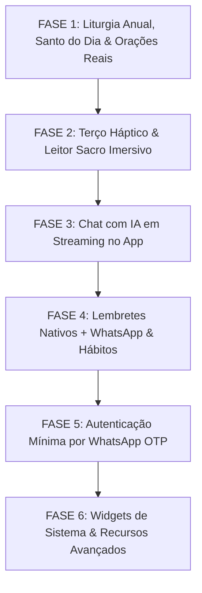

# MarIA Mobile — Roadmap Estratégico & Plano de Evolução

> **Documento:** Roadmap Oficial do Aplicativo Móvel MarIA  
> **Versão:** 1.0.0  
> **Status:** Ativo & Priorizado  
> **Plataformas:** Flutter (iOS & Android) | Backend: NestJS / Supabase  
> **Princípio Central:** *Experiência Híbrida & Complementar (WhatsApp + App Nativo)*  

---

## 1. Visão do Produto & Estratégia Híbrida

O objetivo do MarIA App não é substituir o WhatsApp, mas sim construir uma **experiência complementar sinérgica**:

```
┌────────────────────────────────────────────────────────┐
│                   ECOSSISTEMA HÍBRIDO                  │
├──────────────────────────┬─────────────────────────────┤
│   WHATSAPP (O Mensageiro)│   APLICATIVO (O Santuário)  │
│  - Notificação ativa     │  - Espaço de recolhimento   │
│  - Empurrão diário (Push)│  - Totalmente offline       │
│  - Bate-papo rápido      │  - Visual sacro imersivo    │
│  - Interações espontâneas│  - Rosário tátil & Háptico  │
│  - Lembretes no chat     │  - Liturgia do ano inteiro  │
└──────────────────────────┴─────────────────────────────┘
```

### O que o Aplicativo faz que o WhatsApp NÃO PODE fazer:
1. **Modo Offline Total (Modo Capela/Retiro):** Funciona sem internet dentro de igrejas de pedra, capelas de adoração ou retiros espirituais.
2. **Santo Terço Interativo com Feedback Háptico:** O celular vibra suavemente a cada Ave-Maria; o fiel reza com os olhos fechados sem olhar para a tela.
3. **Leitor Litúrgico Imersivo:** Tipografia ajustável (ideal para idosos e leitura na Missa), espaçamento sacro e modo escuro profundo (OLED/vela).
4. **Player de Áudio em Segundo Plano:** Escutar o Evangelho, reflexão e terço em segundo plano no carro, caminhada ou antes de dormir.
5. **Plano de Vida com Hábitos Visuais & Streaks:** Anéis de progresso, calendário mensal de frequência e histórico de constância devocional.
6. **Privacidade Absoluta (Biometria):** Exame de consciência e diário espiritual protegidos por FaceID/TouchID, sem risco de alguém ler no WhatsApp.
7. **Notificações com Sons Sacros (Sinos de Mosteiro):** Carrilhões e badaladas reverentes que se diferenciam dos sons convencionais de mensagens comuns.
8. **Calendário Litúrgico do Ano Todo:** Navegar livremente por qualquer dia do ano (ver leituras do próximo domingo, Quaresma ou Natal).
9. **Widgets na Tela de Bloqueio (iOS/Android):** Santo do dia e versículo inspirador direto na tela do celular.

---

## 2. Decisão Arquitetural: "Testabilidade First" (Sem Bloqueio de Login)

Para permitir a validação imediata e fluida de todas as funcionalidades pelo usuário e testadores:
* **Autenticação Adiada:** O app funcionará imediatamente em modo visitante/local (`Guest Mode`), salvando progresso e preferências no banco local (`SharedPreferences` / `Hive` / `SQLite`).
* **Autenticação Leve Posterior:** Quando introduzida, a autenticação via WhatsApp OTP servirá unicamente para sincronizar dados em múltiplos dispositivos e carregar o plano pago (Free vs. Premium).

---

## 3. Fases do Roadmap

### 🏁 FASE 1: Fundação de Dados Reais & Modo Offline (Imediata)
*Foco: Trazer dados dinâmicos reais para a tela inicial já existente sem exigir login.*

- [x] **1.1. Integração da Liturgia Diária Completa:**
  - Consumo direto da API Litúrgica (`https://liturgia.up.railway.app/v2/`) e/ou rota do backend.
  - Suporte à consulta de qualquer data do ano (passada e futura) através de seletor de calendário litúrgico.
  - Armazenamento em cache local (offline first): todas as liturgias abertas ficam salvas no dispositivo.
- [x] **1.2. Integração do Santo do Dia:**
  - Conexão com o calendário de santos e memórias litúrgicas com dados ricos de biografia, virtude e oração.
  - Exibição de biografia completa, virtude do dia, oração de intercessão e arte sacra.
- [x] **1.3. Conexão do Catálogo de Orações:**
  - Carregamento de catálogo amplo de orações fundamentais católicas com busca instantânea em tempo real.
  - Cache local permanente de orações para acesso offline instantâneo.
- [x] **1.4. Polimento da Home (Santuário):**
  - Substituição de todos os placeholders da Home por dados reais com tratamento visual para carregamento (`Shimmer`) e offline.

---

### 📿 FASE 2: Experiência Sacra Imersiva & Exclusiva do App
*Foco: Recursos ricos que tornam o app único frente ao WhatsApp.*

- [x] **2.1. Santo Terço Interativo com Feedback Háptico:**
  - Contador visual de contas com transição suave.
  - Motor de vibração háptica (`HapticFeedback.lightImpact`) a cada conta concluída e vibração média nos Glórias e Mistérios.
  - Alternância automática dos mistérios baseada no dia da semana (Gozosos, Dolorosos, Gloriosos, Luminosos).
- [x] **2.2. Leitor Litúrgico Avançado (Leituras da Missa):**
  - Controle de tamanho de texto e espaçamento em tempo real.
  - Modos de leitura: Santuário Diurno (Padrão), Capela Noturna (OLED) e Modo Sepia (Pergaminho).
- [x] **2.3. Exame de Consciência com Sigilo e Reflexão Íntima:**
  - Roteiro diário adaptativo em 4 passos com perguntas compassivas e Ato de Contrição.
  - Anotação de resolução espiritual privada com persistência local segura no dispositivo.

---

### 🕊️ FASE 3: Inteligência Devocional Nativa (Chat com MarIA no App)
*Foco: Conversa acolhedora, privada e em tempo real com a IA.*

- [x] **3.1. Endpoint de Chat no Backend NestJS:**
  - Rota de chat (`/mobile/chat`) conectada ao Magisterium AI, `AiService` e prompts doutrinários.
- [x] **3.2. Interface de Chat Nativa:**
  - Interface devocional com Riverpod `chatNotifierProvider` e indicador visual de digitação.
  - Sugestões contextuais de perguntas rápidas (*"Como lidar com a ansiedade à luz da fé?"*, *"Ajuda para exame de confissão"*, *"Oração pela família"*).
  - Isolamento estrito: o histórico do app não vaza para o WhatsApp para garantir o sigilo íntimo.
  - Opção de limpeza imediata da conversa sob diálogo com foco no sigilo espiritual.
  - Fallback pastoral compassivo e teologicamente ancorado para funcionamento offline.

---

### ⏰ FASE 4: Gestão Unificada de Lembretes & Hábitos
*Foco: Sincronia de horários espirituais entre celular e WhatsApp.*

- [x] **4.1. Lembretes Locais Nativos:**
  - Persistência e gestão de horários de oração via `RemindersLocalDataSource` e `RemindersNotifier`.
  - Sons e badaladas personalizadas (Sinos de Mosteiro, Angelus Clássico, Badalada Suave, Silencioso).
- [x] **4.2. Ponte Híbrida com o WhatsApp:**
  - Opção no lembrete: `[x] Tocar no Celular` e/ou `[x] Enviar mensagem no WhatsApp`.
  - Seleção multicanal integrada na tela `RemindersPage`.
- [x] **4.3. Rastreador de Hábitos do Plano de Vida:**
  - Registro de constância diária e anel circular de progresso (% de santificação com `SpiritualPlanPage`).
  - Persistência local segura dos 5 hábitos centrais e badge dinâmico de streak com feedback háptico.
  - Sincronização em tempo real com `SpiritualHabitsRow` da Home.
- [x] **4.4. Sincronização Bidirecional de Mensagens Diárias do WhatsApp:**
  - Controle centralizado no App para ativar ou cancelar mensagens automáticas da MarIA no WhatsApp (Liturgia Diária matinal, Exame de Consciência noturno e Santo do Dia).
  - Integração em tempo real com as colunas da tabela `users` do Supabase, sincronizando com os botões interativos do chat do WhatsApp.

---

### 🔐 FASE 5: Autenticação Mínima & Identificação (WhatsApp OTP)
*Foco: Identificar assinantes e permitir sincronia entre aparelhos sem complexidade.*

- [ ] **5.1. Backend OTP via Uazapi:**
  - Endpoint `POST /api/v1/mobile/auth/request-otp` despachando código de 6 dígitos no WhatsApp do usuário.
  - Endpoint `POST /api/v1/mobile/auth/verify-otp` emitindo JWT.
- [ ] **5.2. Login Leve no Flutter:**
  - Tela simples de inserção de telefone com máscara internacional.
  - Tela de 6 dígitos com auto-preenchimento.
  - Vinculação transparente: se o telefone já tiver assinatura no WhatsApp (Asaas), o app libera recursos premium automaticamente.

---

### 🌟 FASE 6: Recursos Avançados Nativos & Polimento Final
- [ ] **6.1. Widgets de Tela Inicial (iOS & Android):**
  - Widget com o Santo do Dia e Evangelho na tela principal do celular.
- [ ] **6.2. Player de Áudio em Segundo Plano:**
  - Áudio de reflexão diária e orações narradas com player de barra flutuante.
- [ ] **6.3. Bloqueio Biométrico Opcional:**
  - Autenticação por FaceID/TouchID para proteger anotações de oração e exame de consciência.

---

## 4. Ordem Cronológica de Execução Recomendada



---

## 5. Próximo Passo Imediato

Iniciar a **FASE 1**:
1. Implementar o serviço e repositório de Liturgia Diária com conexão à API litúrgica oficial e cache offline.
2. Permitir a navegação por datas para consultar a liturgia do ano inteiro.
3. Conectar a tela inicial (`HomePage`) para exibir o Evangelho e Santo reais do dia.
