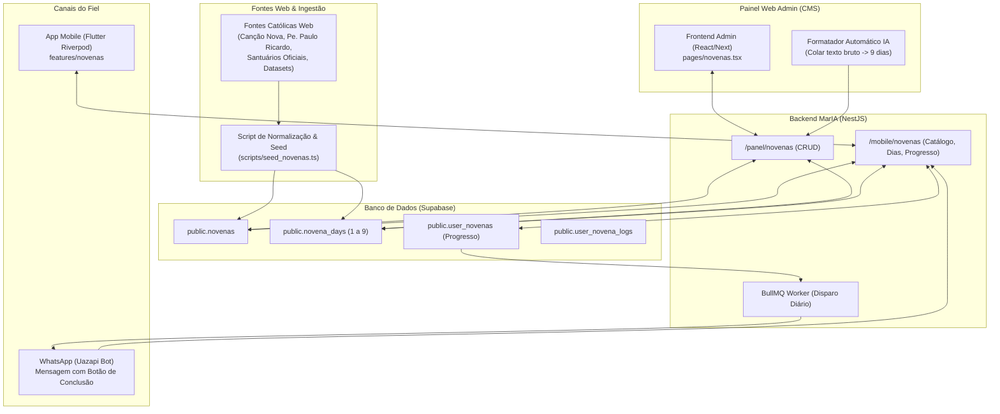

# Arquitetura e Plano de Implementação: Novenário MarIA & Gestão via CMS Admin

> **Status:** Proposta de Arquitetura e Planejamento Técnico  
> **Data:** 14 de Outubro de 2026  
> **Versão Alvo:** 1.31.0  
> **Objetivo:** Estabelecer o Supabase como a Fonte Única da Verdade para as Novenas, construir uma interface completa de CMS no Painel Web Admin, criar um pipeline de ingestão de dezenas de novenas tradicionais e conectar o aplicativo Flutter e o WhatsApp de forma dinâmica e sempre atualizada.

---

## 1. Visão Geral e Princípios Arquiteturais

### 1.1 Princípio Central: Supabase como Fonte Única da Verdade
- **Eliminação de Hardcode:** Nenhuma novena ou texto orante longo deve ficar embutido no código-fonte do aplicativo Flutter.
- **Atualização Dinâmica:** Quando o administrador cadastra, corrige ou adiciona uma nova novena no CMS Admin, todos os usuários do app recebem a novena instantaneamente, sem necessidade de publicar nova versão nas lojas de aplicativos (Google Play / App Store).
- **Offline-First com Cache Inteligente:** O aplicativo móvel baixa as novenas ativas e o catálogo para armazenamento local temporário (cache), permitindo a oração mesmo sem conexão com a internet, sincronizando o progresso (`user_novenas`) assim que a conexão retornar.
- **Engajamento Cruzado (App + WhatsApp):** O fiel pode iniciar a novena pelo app e optar por receber o dia da novena também pelo WhatsApp via Uazapi, com botões interativos para marcar como rezado.

---

## 2. Diagrama de Arquitetura do Sistema



---

## 3. Fontes de Dados na Internet & Estratégia de População

Para garantir o maior catálogo de novenas do Brasil com fidelidade ao Magistério Católico:

### 3.1 Fontes Mapeadas
1. **Editorias de Formação Canção Nova:** Mais de 45 novenas catalogadas dia a dia com orações iniciais, meditações e orações finais.
2. **Padre Paulo Ricardo (Devocionário):** Novenas canônicas de alta devoção (Medalha Milagrosa, Sagrado Coração, São José, Pentecostes, Finados).
3. **Santuários Nacionais e Locais:**
   - Santuário Nacional de Aparecida (Novena da Padroeira).
   - Santuário da Divina Misericórdia (Novena ditada por Jesus a Santa Faustina Kowalska).
   - Associação Amigos de Carlo Acutis / Santuário do Despojamento (Novena Oficial do Beato Carlo Acutis).
   - Santuário de Santa Rita de Cássia e São Judas Tadeu (Causas Impossíveis e Desesperadas).
4. **Acervos e Datasets Open Source:** Datasets em JSON de orações católicas tradicionais em língua portuguesa.

### 3.2 Estratégia de População em 3 Etapas
1. **Lote 1 (Seed Imediato com 10 Grandes Novenas):**
   - Beato Carlo Acutis (Patrono do projeto)
   - Nossa Senhora Desatadora dos Nós
   - São José Operário / São José Terror dos Demônios
   - Terço da Divina Misericórdia / Novena da Misericórdia
   - São Miguel Arcanjo e Milícia Celeste
   - Nossa Senhora Aparecida (Padroeira do Brasil)
   - Santa Teresinha do Menino Jesus (Novena das Rosas)
   - São Judas Tadeu (Causas Desesperadas)
   - Sagrado Coração de Jesus
   - Espírito Santo / Pentecostes
2. **Script de Ingestão & Seed (`scripts/seed_novenas.ts`):**
   - Script automatizado que lê arquivos JSON locais estruturados e insere/atualiza no Supabase via Service Role.
3. **Ferramenta de Colar & Formatar no CMS (Importador Rápido):**
   - No painel web, o administrador pode colar o texto corrido de qualquer novena da internet e a IA do MarIA desmembra automaticamente nos 9 dias estruturados para conferência antes de salvar.

---

## 4. Modelagem do Banco de Dados (Supabase DDL)

Arquivo da migration: `docs/migrations/20261015000000_create_novenas_module.sql`

```sql
-- 1. Tabela Principal de Novenas
CREATE TABLE IF NOT EXISTS public.novenas (
    id UUID DEFAULT extensions.uuid_generate_v4() PRIMARY KEY,
    slug TEXT UNIQUE NOT NULL,
    title TEXT NOT NULL,
    subtitle TEXT,
    description TEXT,
    category TEXT NOT NULL, -- 'marianas', 'santos', 'causas_urgentes', 'jesus', 'espirito_santo', 'liturgicas'
    tags TEXT[] DEFAULT '{}',
    feast_date TEXT, -- Formato 'MM-DD' (ex: '10-12' para Aparecida, '10-12' para Carlo Acutis)
    ideal_start_date TEXT, -- Calculado ou sugerido (9 dias antes da festa)
    image_url TEXT,
    banner_color TEXT DEFAULT '#002D6E',
    is_published BOOLEAN DEFAULT true,
    is_featured BOOLEAN DEFAULT false,
    display_order INTEGER DEFAULT 0,
    created_at TIMESTAMP WITH TIME ZONE DEFAULT NOW(),
    updated_at TIMESTAMP WITH TIME ZONE DEFAULT NOW()
);

-- 2. Tabela dos Dias da Novena (1 a 9)
CREATE TABLE IF NOT EXISTS public.novena_days (
    id UUID DEFAULT extensions.uuid_generate_v4() PRIMARY KEY,
    novena_id UUID REFERENCES public.novenas(id) ON DELETE CASCADE,
    day_number INTEGER NOT NULL CHECK (day_number BETWEEN 1 AND 9),
    title TEXT NOT NULL, -- Ex: "1º Dia: O abandono à Divina Providência"
    opening_prayer TEXT, -- Sinal da Cruz, Ato de Contrição, Oração Inicial
    scripture_reading TEXT, -- Leitura bíblica de apoio
    meditation TEXT NOT NULL, -- Reflexão central do dia
    daily_prayer TEXT NOT NULL, -- Oração própria do dia
    intentions_prompt TEXT, -- Frase motivadora para a intenção particular
    concluding_prayer TEXT, -- Pai Nosso, Ave Maria, Glória e Oração Final
    created_at TIMESTAMP WITH TIME ZONE DEFAULT NOW(),
    UNIQUE(novena_id, day_number)
);

-- 3. Tabela de Novenas do Usuário (Acompanhamento e Progresso)
CREATE TABLE IF NOT EXISTS public.user_novenas (
    id UUID DEFAULT extensions.uuid_generate_v4() PRIMARY KEY,
    user_id UUID REFERENCES public.users(id) ON DELETE CASCADE,
    novena_id UUID REFERENCES public.novenas(id) ON DELETE CASCADE,
    current_day INTEGER DEFAULT 1 CHECK (current_day BETWEEN 1 AND 9),
    status TEXT DEFAULT 'in_progress', -- 'in_progress', 'completed', 'abandoned'
    personal_intention TEXT,
    started_at TIMESTAMP WITH TIME ZONE DEFAULT NOW(),
    last_prayed_at TIMESTAMP WITH TIME ZONE DEFAULT NOW(),
    completed_at TIMESTAMP WITH TIME ZONE,
    reminder_time TEXT DEFAULT '07:00',
    notify_whatsapp BOOLEAN DEFAULT false,
    created_at TIMESTAMP WITH TIME ZONE DEFAULT NOW(),
    updated_at TIMESTAMP WITH TIME ZONE DEFAULT NOW()
);

-- 4. Tabela de Logs Diários de Oração
CREATE TABLE IF NOT EXISTS public.user_novena_logs (
    id UUID DEFAULT extensions.uuid_generate_v4() PRIMARY KEY,
    user_novena_id UUID REFERENCES public.user_novenas(id) ON DELETE CASCADE,
    day_number INTEGER NOT NULL,
    channel TEXT DEFAULT 'mobile', -- 'mobile', 'whatsapp'
    prayed_at TIMESTAMP WITH TIME ZONE DEFAULT NOW()
);

-- Índices de performance
CREATE INDEX IF NOT EXISTS idx_novenas_category ON public.novenas(category);
CREATE INDEX IF NOT EXISTS idx_novenas_published ON public.novenas(is_published);
CREATE INDEX IF NOT EXISTS idx_novena_days_parent ON public.novena_days(novena_id, day_number);
CREATE INDEX IF NOT EXISTS idx_user_novenas_lookup ON public.user_novenas(user_id, status);
```

---

## 5. Módulo CMS no Painel Admin (`frontend/`)

### 5.1 Nova Rota & Navegação
- **Arquivo:** `frontend/src/pages/novenas.tsx`
- **Menu Lateral (`sidebar.tsx`):** Inclusão no submenu de Configurações/Pastoral:
  - Ícone: Rosário/Chama (`Sparkles` ou `BookOpenCheck`)
  - Título: **"Novenário (CMS)"**

### 5.2 Funcionalidades do CMS
1. **Catálogo de Gestão:**
   - Listagem em cards/tabela com busca em tempo real e filtro por categoria e status.
   - Badge de integridade: `9/9 dias preenchidos` (verde) ou `X/9 dias pendentes` (laranja).
   - Toggle rápido: "Em Destaque" e "Publicada no App".
2. **Editor de Novena:**
   - **Cabeçalho:** Título, Subtítulo, Categoria, Tags, Data Festiva e URL da Imagem.
   - **Navegador dos 9 Dias:** Tabs ou carrossel dos dias 1 a 9.
   - Cada dia com campos dedicados:
     - Título do Dia
     - Oração Inicial (com botão "Usar Oração Padrão da Novena")
     - Meditação / Reflexão
     - Oração do Dia
     - Oração de Conclusão
3. **Assistente de Ingestão Inteligente ("Importar Texto"):**
   - Modal onde o administrador cola o texto completo de uma novena encontrada na internet.
   - Um botão *"Processar com IA"* envia para o backend, que usa o LLM para separar em JSON os 9 dias e preencher o formulário automaticamente para revisão humana.

---

## 6. Módulo Backend NestJS (`backend/src/novenas/`)

### 6.1 Estrutura do Módulo
- `novenas.module.ts`: Declaração do módulo e injeções.
- `novenas.controller.ts`: Endpoints administrativos (`/panel/novenas`) e móveis (`/mobile/novenas`).
- `novenas.service.ts`: Lógica de persistência no Supabase, paginação, filtros e controle de dias.

### 6.2 Endpoints Principais
| Método | Rota | Descrição |
|---|---|---|
| `GET` | `/panel/novenas` | Listagem administrativa completa com contagem de dias |
| `GET` | `/panel/novenas/:id` | Detalhes da novena e todos os 9 dias |
| `POST` | `/panel/novenas` | Criação de novena e seus dias |
| `PATCH` | `/panel/novenas/:id` | Atualização cadastral e de conteúdo |
| `DELETE` | `/panel/novenas/:id` | Remoção |
| `POST` | `/panel/novenas/ai-parse` | Parser assistido por IA de texto bruto para 9 dias |
| `GET` | `/mobile/novenas` | Catálogo público para o app (com destaques e novenas sugeridas) |
| `GET` | `/mobile/novenas/:id` | Detalhes da novena para leitura/oração |
| `POST` | `/mobile/novenas/:id/start` | Inicia o percurso da novena para o usuário logado |
| `GET` | `/mobile/novenas/active` | Retorna as novenas atualmente em andamento do fiel |
| `POST` | `/mobile/novenas/user-novena/:id/check-day` | Conclui o dia e avança a jornada |

---

## 7. Módulo Mobile Flutter (`mobile/lib/features/novenas/`)

### 7.1 Arquitetura Feature-First
- `features/novenas/`
  - `data/`
    - `models/novena_model.dart`
    - `models/novena_day_model.dart`
    - `models/user_novena_model.dart`
    - `datasources/novenas_remote_data_source.dart`
    - `datasources/novenas_local_cache.dart`
  - `domain/`
    - `entities/novena.dart`
    - `entities/novena_day.dart`
  - `presentation/`
    - `controllers/novenas_controller.dart` (Riverpod StateNotifier)
    - `pages/novenas_catalog_page.dart` (Vitrine de novenas do Supabase)
    - `pages/novena_detail_page.dart` (Apresentação e compromisso de intenção)
    - `pages/novena_prayer_day_page.dart` (Ambiente imersivo de oração dos 9 dias)
    - `widgets/novena_progress_beads.dart` (9 contas douradas interativas)

### 7.2 Experiência Visual do Fiel
- **Santuário Claro / Capela Noturna:** Perfeita harmonia com o tema oficial MarIA (`#002D6E` Azul Sagrado e `#D4AF37` Ouro Real).
- **Indicador dos 9 Dias:** Estilo contas de terço ou velas acesas (`Vela 1..9`). Ao rezar, a chama se acende com animação sutil.
- **Intenção Pessoal Relembrada:** Todo dia, antes de iniciar a oração, o app exibe uma lembrança carinhosa: *"Sua intenção para esta novena: [pedido do fiel]"*.

---

## 8. Cronograma de Implementação Passo a Passo

### Fase 1: Fundação de Dados & Migration no Supabase
- [ ] Criar arquivo de migration `docs/migrations/20261015000000_create_novenas_module.sql`.
- [ ] Criar script de sementeira inicial com as primeiras 10 grandes novenas clássicas.
- [ ] Executar migration e validar permissões RLS.

### Fase 2: Backend NestJS (Módulo `novenas`)
- [ ] Gerar módulo, controller e service em `backend/src/novenas/`.
- [ ] Implementar endpoints do painel administrativo (`/panel/novenas`).
- [ ] Implementar endpoints do app mobile (`/mobile/novenas`).
- [ ] Conectar ao `AppModule` e validar build Docker.

### Fase 3: CMS Web Admin (`frontend/src/pages/novenas.tsx`)
- [ ] Construir página de listagem de novenas com filtros e ordenação.
- [ ] Construir modal/formulário completo de edição dos 9 dias.
- [ ] Adicionar botão de ingestão rápida (assistente com prompt de divisão de texto).
- [ ] Atualizar menu lateral (`sidebar.tsx`).

### Fase 4: Aplicativo Mobile Flutter (`mobile/`)
- [ ] Criar entidade e data source conectando à rota do backend/Supabase.
- [ ] Criar tela de catálogo ("Novenário Sagrado") com abas e busca.
- [ ] Criar tela de oração imersiva dos 9 dias com persistência de progresso e intenção.
- [ ] Adicionar atalho nobre na Home e na página de Orações.
- [ ] Testes de widget e compilação do APK de debug.

### Fase 5: Integração WhatsApp & Lembretes
- [ ] Conectar o agendador de lembretes ao `RemindersProcessor` para suporte a novenas ativas.
- [ ] Atualizar documentação (`README.md`, `CHANGELOG.md` e `context/context.md`).
